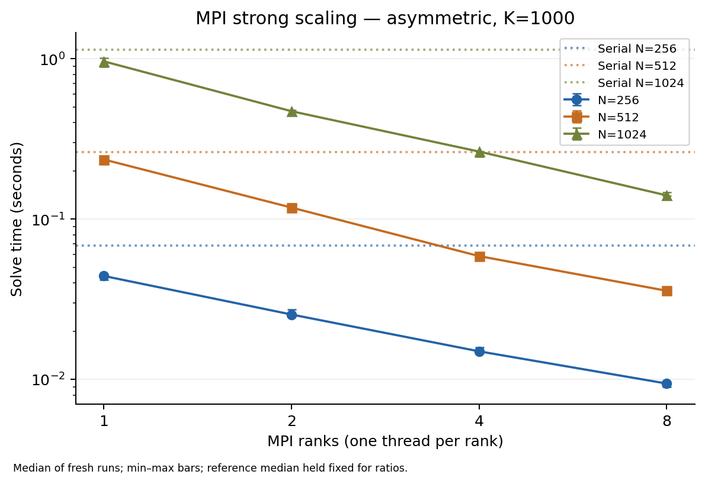
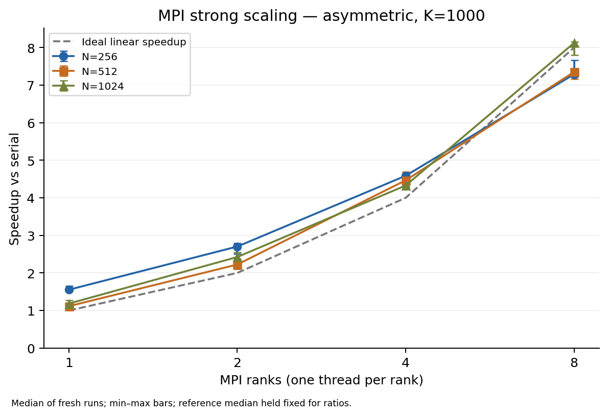
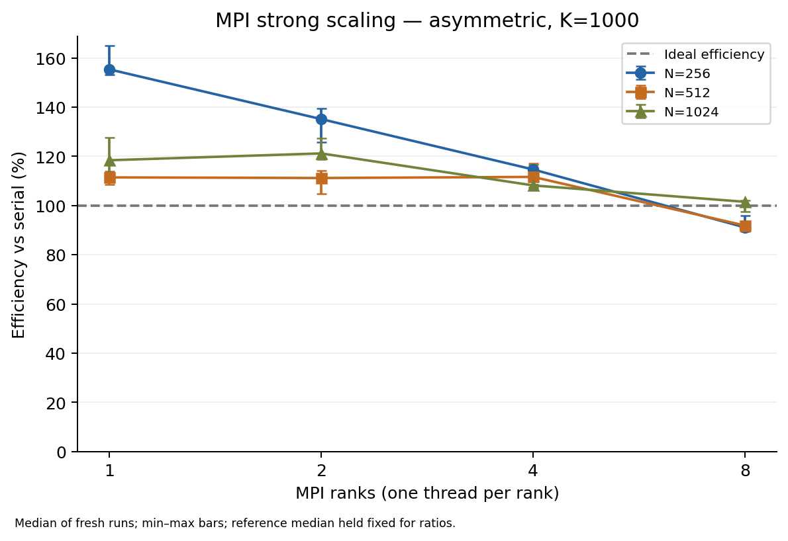
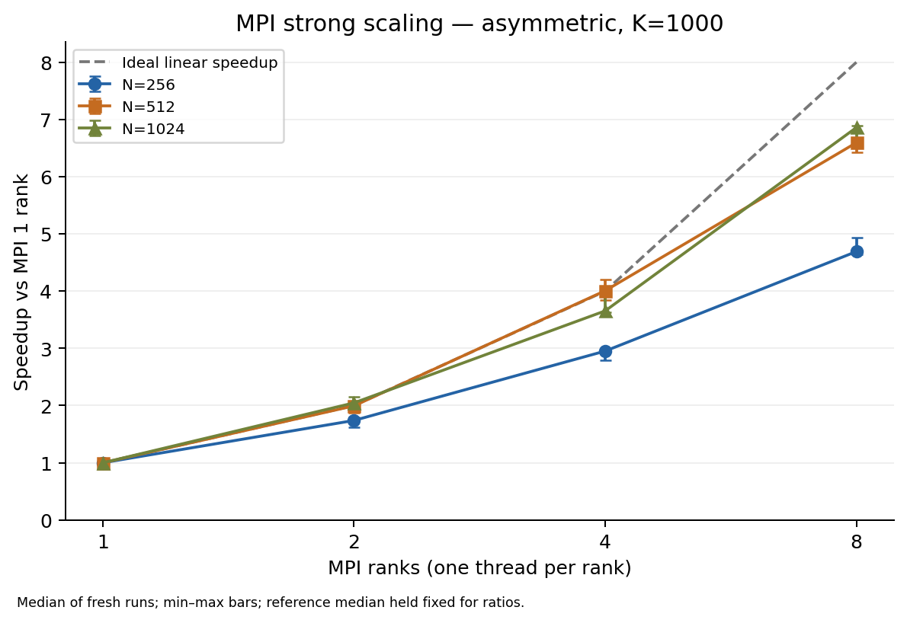
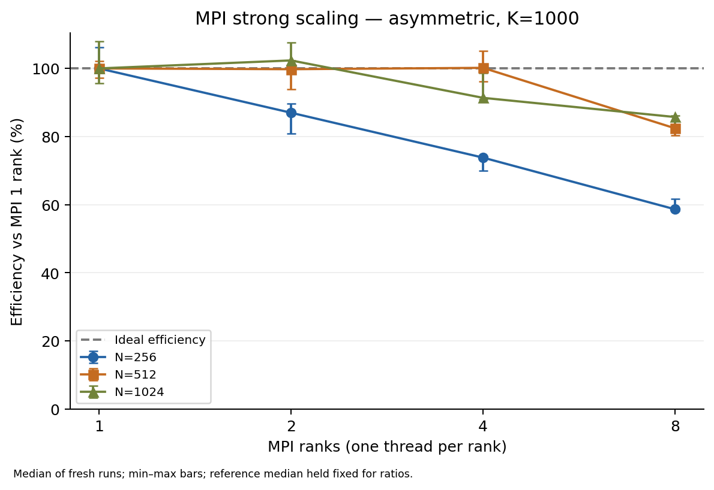

# MPI-only parallelization of the Jacobi solver

**Measured MPI section for group integration.** Vanda job
`1539665.stdct-mgmt-02` compiled and validated source commit `0e1c267`, passed
162 MPI checks and collected 45 strong-scaling measurements on 11 November 2026.
Downloaded grids, raw records, summary arithmetic, validation hashes and core
bindings were independently audited. This section supplements A's algorithm
introduction and C's OpenMP/hybrid sections; hybrid integration is not claimed.

## Domain decomposition and storage

We parallelize the agreed five-point Jacobi discretization of the two-dimensional
Poisson equation using a one-dimensional decomposition of its N interior rows.
For P MPI ranks, let q=floor(N/P), r=N mod P. Rank p owns

$$
n_p=q+\mathbf{1}_{p<r},\qquad s_p=1+pq+\min(p,r).
$$

Here s_p is the first owned global row. Local row i maps to global row s_p+i-1;
the global y coordinate is therefore (s_p+i-1)h, where h=1/(N+1). Each rank owns
complete rows, so columns require no inter-rank communication. Ranks>N are
rejected because the design assumes at least one owned row per rank.

The owned row counts differ by at most one. For example, N=10 and P=3 gives
4,3,3 rows with first global rows 1,5,8. Unlike a simple N/P truncation, this
rule covers the entire interior without overlapping ownership. Each rank stores
two solution arrays and the unscaled forcing array, each of size
(n_p+2)(N+2). Local rows 0 and n_p+1 are halo rows, while columns 0 and N+1 are
physical zero boundary columns. The first and last global halo rows are also zero.
Approximate local array storage is 3(n_p+2)(N+2) times sizeof(double), excluding
MPI overhead. Optional CSV export additionally allocates a complete grid on root.

A row decomposition provides contiguous communication buffers and a small,
reusable interface for the hybrid version. Compared with a two-dimensional
decomposition, it avoids column datatypes and additional neighbor bookkeeping.
Its limitation is that a halo row remains length N+2 as P grows, while owned
computation shrinks; the implementation also cannot use more than N ranks.

## Halo exchange and iteration ordering

Every iteration exchanges the boundary rows of the old solution before updating
any interior point. With rank p-1 as the upper neighbor and p+1 as the lower
neighbor, the first MPI_Sendrecv sends the first owned row upward (tag 100) and
receives the lower neighbor's first owned row into the lower halo. The second
sends the last owned row downward (tag 101) and receives the upper neighbor's
last owned row into the upper halo. Endpoints use MPI_PROC_NULL and explicit
zero boundary halos. Separate tags distinguish the two directions. The send and
receive buffers do not overlap, including when each rank owns only one row.

MPI_Sendrecv avoids the cyclic dependency that can occur when all ranks perform
a blocking send before posting any receive. Both exchanges complete before the
stencil reads the halos. The local stencil then reads exclusively from the old
array and writes exclusively to the next array. After the local update, the
buffers are swapped. The code does not introduce a global barrier every iteration.

Fixed mode performs exactly K iterations without an update-norm reduction. In
convergence mode, each rank computes its maximum local update and MPI_Allreduce
with MPI_MAX obtains the global infinity norm. The implementation swaps first,
then reduces and tests that norm; consequently the retained solution is the new
iterate, including on the stopping iteration. Every rank receives the same norm
and makes the same stopping decision. Reaching the maximum iteration count
without convergence is reported explicitly with exit code 3.

All MPI calls execute on the main thread. Initialization requests and checks
MPI_THREAD_FUNNELED, so C can reuse the decomposition and exchange code around
OpenMP local loops. C's kernel expects pre-scaled h²f; the MPI baseline stores
unscaled f to match A. Integration must account for that interface difference.

## Correctness argument

Initially, every owned interior and physical boundary value is zero, matching the
serial initial grid. Assume that before iteration k each owned interior value
equals its serial counterpart. Halo exchange copies the adjacent owned rows of
that same iterate into the receiver's halos. Physical endpoints remain zero.
Thus every local update reads the same four neighbor values and forcing value as
the serial update at the corresponding global coordinate. It applies the same
arithmetic expression and writes a distinct next-buffer location. Swapping the
buffers therefore preserves the correspondence for iteration k+1. By induction,
the assembled fixed-iteration MPI grid represents the same Jacobi sequence.

In convergence mode, the global maximum of local maxima equals the maximum over
the entire interior. Consequently the serial and distributed stopping tests
apply to the same iterate and mathematical norm. Numerical comparison is still
required because compilation and floating-point details can affect actual output.

The final swap leaves halos that may belong to an earlier iterate, so the solver
refreshes the current halos again before evaluating the residual. It computes

$$
R_\infty=\max_{i,j}|f_{i,j}-(4u_{i,j}-u_{i-1,j}-u_{i+1,j}
 -u_{i,j-1}-u_{i,j+1})/h^2|,
$$

and the maximum error against the manufactured continuum solution over owned
interiors, followed by global maximum reductions. The update norm, discrete
residual and continuum error measure different quantities and are reported
separately. A small update norm alone is not evidence that all three are small.

CSV export uses MPI_Gatherv because row counts can differ. Each rank sends only
owned rows, including physical boundary columns but excluding halo rows. Root
places them at their global row displacements in a zero-initialized complete
grid. This includes every interior exactly once and inserts each physical
boundary row once. The implementation bounds counts and displacements to the
supported MPI integer range. Only root prints the primary JSON result.

## Numerical validation protocol

The automated validator compares both symmetric and asymmetric manufactured
solutions against A's serial executable. The asymmetric mode is particularly
useful for detecting wrong y-coordinate offsets or reversed row ordering.
Cases include P=1; N=10,P=3; N=P; odd and even iteration counts; converged solves;
and intentionally exhausted solves. Additional serial/MPI comparisons include
N=2,K=1, N=10,K=100 and N=32,K=500. Full-grid values use the agreed tolerance
|u_MPI-u_serial| <= 1e-10 + 1e-8|u_serial|, with no automatic relaxation.
The validator checks boundaries, JSON fields, actual ranks, iteration counts,
final update norms, residuals and errors. Invalid inputs and attempts to overwrite
an existing CSV must fail without leaving peers blocked.

An independent MPI continuum-refinement test uses N=15,31,63 with the asymmetric
solution and update tolerance 1e-13. It requires a final residual below 2e-8 and
error ratios between 3.8 and 4.2 under halving of h, consistent with a
second-order discretization. A also supplies independent discrete eigenmode
tests for the serial reference.

### Observed validation results

The Vanda job passed all five CTest suites and all 162 MPI checks: 144 paired
full-grid comparisons, 15 invalid-input/output-failure checks and three
refinement solves. Ranks 1,2,3,4,8 were covered. All 144 downloaded serial/MPI
grid pairs were independently reread: the largest absolute difference across
their parsed values was exactly 0, and physical boundaries were zero. This
observed agreement applies to the tested cases and compiler, rather than being
a guarantee of bitwise equivalence on all platforms.

For the nondivisible N=10,P=3,K=100 case:

| Problem | Max serial/MPI grid difference | Final residual | Continuum error |
| --- | ---: | ---: | ---: |
| Symmetric | 0 | 0.3094734023 | 0.0090982814 |
| Asymmetric | 0 | 0.0013385728 | 0.0229052949 |

These fixed-iteration cases need not be converged to validate agreement with the
serial Jacobi sequence. Independently, the tightened eight-rank asymmetric
refinement solves produced:

| N | Iterations | Error infinity norm | Residual infinity norm | Previous/current error |
| --- | ---: | ---: | ---: | ---: |
| 15 | 552 | 0.01098931492 | 9.6414e-11 | — |
| 31 | 2112 | 0.002734954824 | 4.0362e-10 | 4.0181 |
| 63 | 8006 | 0.0006829683607 | 1.6313e-9 | 4.0045 |

The error ratios approach four as h halves, supporting second-order continuum
accuracy when iteration error is sufficiently small. The evidence archive is
[`results/vanda/mpi-1539665.stdct-mgmt-02`](../results/vanda/mpi-1539665.stdct-mgmt-02/).
It contains grids, commands and raw outputs as well as the local audit receipt.

## Timing and strong-scaling protocol

Initialization, allocation and construction of the forcing array occur before
timing. MPI_Barrier synchronizes the timing start; MPI_Wtime measures the complete
iteration loop independently on each rank. The first and subsequent halo
exchanges, local updates, swaps and convergence reductions are included. The
reported solve time is the maximum elapsed time across ranks. The timing
reduction itself, final halo refresh, diagnostics, gathering and file output
are excluded. The serial reference times the corresponding iteration loop.

The measured single-node sweep used N=256,512,1024, fixed K=1000, the asymmetric
problem and P=1,2,4,8. The active PBS allocation and physical-core availability
are checked, each MPI rank uses one thread, and Open MPI binds ranks to cores
without oversubscription. The serial baseline runs on the same compute node
with a one-process binding policy. One warmup and three fresh runs were
performed per configuration; measurement order rotated across repetitions.

The node was GN-A40-075 with Intel Xeon Platinum 8452Y processors. PBS allocated
eight physical cores; launcher logs placed all active ranks on distinct cores
of socket 1, without warning messages. The experiment used GCC 11.3.0, C++17,
Release -O3 without fast-math, Open MPI 4.1.4, CMake 3.24.3, and the single-node
launcher workaround documented by C. This is a CPU experiment; the node's A40
name does not indicate CUDA use. Metadata records an actual memory allocation
of 55 GB, whereas the repository PBS template requests 8 GB; reported resources
here follow the captured allocation. The node had other hardware resources
outside the eight-core job cpuset; they were not counted as compute resources.

Define T_s as the median serial solve time and T_P as the median P-rank MPI time:

$$
S(P)=T_s/T_P,\qquad E(P)=S(P)/P.
$$

T_MPI(1)/T_MPI(P) is retained as a separate measure of MPI scaling; it is not
substituted for serial-relative speedup. Runtime figures show median times and
min–max ranges. Speedup and efficiency ranges hold the serial median fixed and
transform MPI extrema; they are descriptive ranges, not confidence intervals.
P counts actively used compute cores. The eight-core reservation made for the
entire sweep is separately recorded and should not be confused with active-core
efficiency.

The raw records preserve every measured solver JSON and launcher stderr.
Metadata records node/allocation, CPU details, compiler and MPI versions, source
revision and working-tree status, binary hashes and the validation evidence hash.
Only same-node validated binaries can enter the benchmark script. Analysis
regenerates summaries and figures from raw measurements and rejects incomplete
or inconsistent sweeps.

## Performance model

Ignoring row remainders, each rank performs O(KN²/P) stencil work. A middle rank
sends two N+2-element rows per iteration and receives two; a boundary rank has
one neighbor. A simple qualitative fixed-mode model is

$$
T_P \approx K\left(cN^2/P+2\alpha+2\beta(N+2)\right),
$$

where c denotes effective local stencil cost, alpha message latency and beta
effective cost per transmitted double. This model treats each Sendrecv as one
effective neighbor-exchange phase and omits topology, bandwidth contention,
protocol effects and overlap. It is not a fitted prediction. Convergence mode
adds a global-reduction cost each iteration and is not mixed into the fixed-work
strong-scaling sweep.

Increasing P reduces local compute work while the row-message length remains
constant. Communication, synchronization and memory-bandwidth limits can thus
restrict scaling, especially for smaller N. Larger N can improve the
compute-to-communication ratio, but may change cache and memory behavior. Row
remainder imbalance is at most one row. Its significance depends on N/P.
The blocking baseline does not overlap halo transfers with interior updates.

## Measured MPI performance and interpretation

The following table reports median solver time in milliseconds, serial-relative
speedup S_s=T_s/T_P, and MPI-one-rank-relative speedup S_1=T_MPI(1)/T_P.
The corresponding active-core efficiencies are E_s=S_s/P and E_1=S_1/P,
expressed as percentages in the table. Every configuration uses one thread per rank.

| N | Serial time (ms) | MPI ranks | MPI time (ms) | S_s | E_s (%) | S_1 | E_1 (%) |
| --- | ---: | ---: | ---: | ---: | ---: | ---: | ---: |
| 256 | 68.661 | 1 | 44.195 | 1.554 | 155.4 | 1.000 | 100.0 |
| 256 | 68.661 | 2 | 25.403 | 2.703 | 135.1 | 1.740 | 87.0 |
| 256 | 68.661 | 4 | 14.968 | 4.587 | 114.7 | 2.953 | 73.8 |
| 256 | 68.661 | 8 | 9.421 | 7.288 | 91.1 | 4.691 | 58.6 |
| 512 | 262.457 | 1 | 235.477 | 1.115 | 111.5 | 1.000 | 100.0 |
| 512 | 262.457 | 2 | 118.005 | 2.224 | 111.2 | 1.995 | 99.8 |
| 512 | 262.457 | 4 | 58.768 | 4.466 | 111.6 | 4.007 | 100.2 |
| 512 | 262.457 | 8 | 35.711 | 7.350 | 91.9 | 6.594 | 82.4 |
| 1024 | 1141.330 | 1 | 963.796 | 1.184 | 118.4 | 1.000 | 100.0 |
| 1024 | 1141.330 | 2 | 470.832 | 2.424 | 121.2 | 2.047 | 102.4 |
| 1024 | 1141.330 | 4 | 263.716 | 4.328 | 108.2 | 3.655 | 91.4 |
| 1024 | 1141.330 | 8 | 140.523 | 8.122 | 101.5 | 6.859 | 85.7 |

Runtime decreased at every tested increase in rank count for all three grids.
At eight ranks, serial-relative speedups were 7.288, 7.350 and 8.122. These values
include a substantial single-rank implementation difference: MPI at one rank was
already 1.554, 1.115 and 1.184 times faster than the serial reference. For this
reason, efficiencies above 100% must not be attributed solely to adding ranks.
Both solvers use the same mathematical update and verified output, but their
loop/indexing structures differ. Compiler optimization, cache behavior and
system variability are possible contributors; none was isolated experimentally.

With MPI one rank held as the reference, the eight-rank speedups are 4.691,
6.594 and 6.859, corresponding to efficiencies of 58.6%, 82.4% and 85.7%. Thus
larger grids exhibit better eight-rank scaling within the same MPI code path.
For N=256 the median falls from 44.195 ms to 9.421 ms rather than the ideal
5.524 ms. At N=512, scaling is approximately linear up to four ranks before
eight-rank efficiency falls to 82.4%. These trends are consistent with fixed
communication costs becoming more prominent as local work shrinks. The results
do not separate communication time, memory bandwidth or cache effects, so no
single bottleneck is established.

The slight MPI-one-rank-relative efficiencies above 100% for N=512,P=4 and
N=1024,P=2 should also be interpreted cautiously with only three repetitions.
The N=1024 serial timings range from 0.93644 to 1.15263 seconds (median 1.14133),
and MPI-one-rank timings from 0.89336 to 1.00743 seconds (median 0.96380). This
baseline variability affects both ratios. At eight ranks the N=1024 MPI range is
0.13990–0.14633 seconds. The plotted min–max bars preserve observed variability;
they are not confidence intervals, and three samples do not support a precise
statistical claim of superlinear scaling.

All benchmark runs at a given N have identical reported residual and continuum
error across serial/MPI rank configurations. However, K=1000 is intentionally a
fixed workload, not a converged solve: the errors for N=256,512,1024 are about
0.8296,0.9542,0.9883, with residuals 40.94,47.09,48.77. These large values reflect
remaining iteration error from zero initialization. They do not contradict the
separately converged refinement test. The benchmark evaluates throughput for the
same Jacobi sequence, not time to a prescribed solution accuracy.

The scope is single-node strong scaling through eight cores for one manufactured
asymmetric problem and one fixed iteration count. No multinode, weak-scaling,
GPU, nonblocking-communication or hybrid performance claim is made. A follow-up
study could increase repetitions and isolate local-kernel and communication
costs to resolve baseline differences and scaling limits.

## AI assistance

ChatGPT assisted with source inspection, MPI implementation, validation and
benchmark tooling, analysis code and this technical section. A's mathematical
contract and serial source were retained; C's existing launch/allocation
utilities were reused with commit attribution in the handoff. Local Python
tooling checks are separate from cluster solver validation. The student submitted
the actual Vanda jobs, supplied their logs and downloaded the original outputs.
ChatGPT checked the transferred validation/grid evidence, raw summaries and
binding records, generated figures and drafted the interpretation. No timing or
validation result in this section was synthesized. Group review and integration
with A/C's sections remain necessary before submission.
